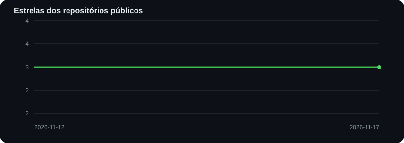

# GitHub Pulse | Painel de métricas públicas

> Este painel é atualizado automaticamente. Os commits de coleta não representam atividade manual de programação.

**Perfil monitorado:** [DanielLinsAndrade](https://github.com/DanielLinsAndrade)  
**Última coleta:** 2026-11-25T01:34:26-03:00 (America/Fortaleza)

## Indicadores

| Indicador | Atual | Diferença para a coleta anterior |
| :-- | --: | --: |
| Repositórios públicos próprios | 9 | 0 |
| Estrelas recebidas | 3 | 0 |
| Forks recebidos | 0 | 0 |
| Issues abertas (aproximação da API) | 0 | 0 |

## Histórico visual

## Repositórios em destaque

| Projeto | Linguagem | Estrelas | Forks | Último push |
| :-- | :-- | --: | --: | :-- |
| [GerenciamentoDeConsultasMedicas](https://github.com/DanielLinsAndrade/GerenciamentoDeConsultasMedicas) | Python | 1 | 0 | 2024-12-05 |
| [Island_Kraken](https://github.com/DanielLinsAndrade/Island_Kraken) | — | 1 | 0 | 2022-11-24 |
| [Projeto-MNIST](https://github.com/DanielLinsAndrade/Projeto-MNIST) | Python | 1 | 0 | 2025-06-07 |
| [8-Puzzle-Challenge-IDS](https://github.com/DanielLinsAndrade/8-Puzzle-Challenge-IDS) | Python | 0 | 0 | 2025-10-16 |
| [AntiSpoiler](https://github.com/DanielLinsAndrade/AntiSpoiler) | JavaScript | 0 | 0 | 2024-09-18 |
| [DanielLinsAndrade](https://github.com/DanielLinsAndrade/DanielLinsAndrade) | — | 0 | 0 | 2026-09-26 |
| [dinheirovisky](https://github.com/DanielLinsAndrade/dinheirovisky) | TypeScript | 0 | 0 | 2026-09-26 |
| [Gerenciamento-de-inventario](https://github.com/DanielLinsAndrade/Gerenciamento-de-inventario) | Python | 0 | 0 | 2025-01-07 |
| [IrminsulAtlas](https://github.com/DanielLinsAndrade/IrminsulAtlas) | TypeScript | 0 | 0 | 2026-09-28 |

## Últimas coletas

| Data | Repositórios | Estrelas | Forks |
| :-- | --: | --: | --: |
| 2026-11-25 | 9 | 3 | 0 |
| 2026-11-24 | 9 | 3 | 0 |
| 2026-11-23 | 9 | 3 | 0 |
| 2026-11-22 | 9 | 3 | 0 |
| 2026-11-21 | 9 | 3 | 0 |
| 2026-11-20 | 9 | 3 | 0 |
| 2026-11-19 | 9 | 3 | 0 |
| 2026-11-18 | 9 | 3 | 0 |
| 2026-11-17 | 9 | 3 | 0 |
| 2026-11-16 | 9 | 3 | 0 |
| 2026-11-15 | 9 | 3 | 0 |
| 2026-11-14 | 9 | 3 | 0 |
| 2026-11-13 | 9 | 3 | 0 |
| 2026-11-12 | 9 | 3 | 0 |

Dados completos: [`data/history.csv`](data/history.csv) e arquivos JSON diários em [`data/daily`](data/daily).
